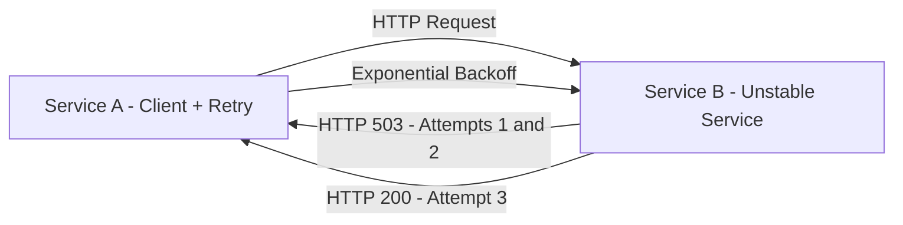

# Retry Pattern

## Description

This project demonstrates the Retry Pattern using two independent Python microservices built with FastAPI.

Service A acts as the client and implements the retry mechanism. Service B simulates temporary failures by returning HTTP 503 for the first two requests and HTTP 200 from the third request onward.

## Architecture



## Technologies

- Python
- FastAPI
- Uvicorn
- Requests
- PyYAML

## Configuration

Retry parameters are defined in `config/retry-config.yml`:

- Maximum attempts: 3
- Initial delay: 1 second
- Backoff multiplier: 2

## Execution

Install dependencies:

```bash
pip install -r 01-retry-pattern/requirements.txt
```

Start Service B:

```bash
python -m uvicorn main:app --app-dir 01-retry-pattern/src/service-b --host 127.0.0.1 --port 8001
```

Start Service A in another terminal:

```bash
python -m uvicorn main:app --app-dir 01-retry-pattern/src/service-a --host 127.0.0.1 --port 8000
```

Execute the retry operation:

```text
http://127.0.0.1:8000/execute
```

## Expected behavior

1. First request: HTTP 503.
2. Wait 1 second.
3. Second request: HTTP 503.
4. Wait 2 seconds.
5. Third request: HTTP 200.
6. Service A completes the operation successfully.

## Evidence

Screenshots of the service logs and successful HTTP response are stored in the `evidence/` directory.
